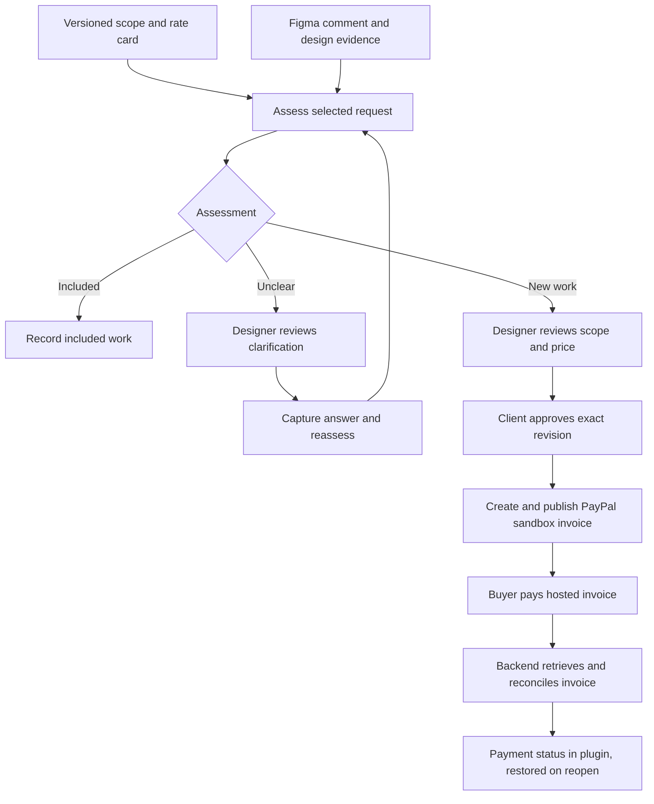

# Scope & Settle: working product specification

Version 0.1 · October 22, 2026

This is the consolidated reference for the product direction, intended behavior, technical outline, validation work, and open questions discussed so far. It supersedes the [initial design outline](superpowers/specs/2026-10-22-scope-and-settle-design.md). Provider setup details remain in [SETUP-STATUS.md](SETUP-STATUS.md).

This October 22 specification preserves the original product decisions and feasibility history. The [current product contract](PRODUCT-SPEC.md) and [0.3.0 qualification](CLIENT-AGENT-VERIFICATION-2026-10-23.md) supersede its older implementation-status statements. Actual sandbox payments, signed PayPal callbacks, independent Figma edit/native access, and configured-file comment read/write are recorded in the dated verification documents. The [integration baseline](verification/agent-integrations-baseline.md) separates that inherited evidence from the locally changed candidate, whose deployment and release acceptance remain unverified. Detailed interfaces below remain requirements unless demonstrated by the relevant acceptance record.

## 1. Product in one paragraph

Scope & Settle is a Figma plugin that helps a freelance designer or small studio turn a casual client request into a clear scope and payment decision. It compares a Figma comment and selected design evidence with the agreed project scope, explains whether the request is already included, additional work, or unclear, and helps the designer prepare a priced change order. The client approves the exact scope and price before the backend creates a PayPal invoice. Payment status returns to the same project inside the plugin.

**Core sequence:** agreement → evidence → assessment → proposal → approval → invoice → confirmed payment.

The initial audience is designers working on fixed-price engagements with identifiable deliverables and a client who can approve additional work. The opportunity is to reduce the effort and awkwardness of interpreting requests, explaining charges, and following up on payment. The first demonstration can establish value for this specific setting; applicability across every type of creative engagement is not a prerequisite.

## 2. Decisions already made

| Decision | What it means for the first build |
| --- | --- |
| Build Scope & Settle first | Prioritize a complete, convincing workflow with two parties, one Figma file, and one invoice per change order. |
| Use Figma as the primary product surface | Meet the designer where requests and design context already exist. A separate browser page supports client review and approval. |
| Make scope judgment the central AI interaction | The same request can be included, additional work, or ambiguous depending on the agreement and evidence. |
| Keep commercial decisions explicit | AI proposes; the designer reviews; the client approves the exact scope and price. |
| Make PayPal part of the workflow | The invoice is tied to an approved change-order revision, and authoritative payment status is visible in the plugin. |
| Start with a small sandbox demonstration | One designer, one client, one configured Figma file, one sandbox merchant and buyer, and USD. |
| Validate the integration before expanding the product | Prove Figma comment access through the plugin/backend to a payable sandbox invoice and back to persisted payment status. |
| Keep the full demonstration under three minutes | Every main step must be visible and understandable on camera. |

Merchant Negotiator remains the alternative if a concrete feasibility blocker prevents this workflow. Its distribution potential was attractive, but group coordination would make the first demonstration more complex. Outcome Billing is parked pending a billing-access test. Stock Rescue and Seller Settlement Desk are parked because their required provisioning was not established. These are sequencing decisions, not conclusions that the concepts lack value. The supporting access inventory is in [PAYPAL-API-CAPABILITIES.md](../PAYPAL-API-CAPABILITIES.md).

## 3. Working technical choices

These choices appeared in the earlier design and remain the planning baseline. Package selection, authentication mechanics, hosting, and the AI provider still need resolution.

| Area | Working choice |
| --- | --- |
| Application language | TypeScript for the plugin, backend, browser review page, and shared contracts. |
| Backend | One Node.js service responsible for provider calls, validation, approval records, pricing, and payment reconciliation. |
| Persistence | SQLite for project state, immutable revisions, approvals, invoice operations, and payment observations. |
| Figma access | A server-held personal access token for the single-user prototype, restricted by the backend to the configured file. |
| Design context | Selected document content from the running plugin; a selected frame image when supported by the chosen model and demo. |
| AI integration | One server-side provider/model with structured output; final model and image requirements are open. |
| PayPal | Sandbox Invoicing v2 and hosted invoice payment, followed by authoritative status retrieval. |
| Payment updates | Verified webhooks plus explicit refresh/reconciliation. Direct refresh can establish the first payment round-trip before webhook delivery is proven. |
| Access separation | Distinct designer and client sessions, with authorization enforced by the backend. |
| Initial distribution | A locally imported development plugin and documented setup. Public Figma distribution and multi-user OAuth are later work. |

## 4. First demonstration

The designer has an agreed desktop checkout project. The client leaves: “Can you add the mobile checkout?” The plugin identifies the scope clause excluding mobile layouts and proposes a mobile-checkout change order. The designer reviews the deliverable and price. The client approves that revision, pays its sandbox invoice, and the plugin shows the confirmed payment.

The existing synthetic rate card uses **$250 for mobile checkout layouts** and **$100 for an additional onboarding screen**. These are test values, not validated market rates or final pricing. The mobile case is the main story; the extra rate entry does not expand the required demo.

The judgment test repeats the same request against three baselines:

| Agreed scope | Expected result | What the explanation must establish |
| --- | --- | --- |
| Desktop and responsive mobile layouts are included | Already included | Cite the clause covering mobile work. |
| Desktop only; mobile layouts are explicitly excluded | New work | Cite the exclusion and identify the additional deliverable. |
| Mobile support is mentioned without a defined commitment | Needs clarification | Identify the uncertainty and ask a question that resolves it. |

An absent mobile frame is evidence about the current design, not proof that mobile work falls outside the agreement. The assessment must distinguish those facts.

## 5. MVP scope

| Required capability | Intended behavior |
| --- | --- |
| Project setup | Bind the demo file, designer, client, merchant, currency, scope baseline, and rate card to one project. |
| Versioned scope | Save identifiable revisions of the agreement and rate card; retain the revision used for each assessment. |
| Request selection | Read actual Figma comments and let the designer select a request and relevant design context. |
| Evidence-based assessment | Return included, new work, or needs clarification, with traceable support and visible uncertainty. |
| Proposal editing | Let the designer review deliverables, rate entries, quantities, price, and explanation. |
| Client review | Present the exact proposed change and total on a browser page, with an explicit approval action. |
| Invoicing | Create and publish one sandbox invoice for the approved revision and expose its hosted payment link. |
| Payment tracking | Display retrieved invoice/payment status, amount due, and when status was last checked. |
| Recovery | Restore persisted state after the plugin closes or the backend restarts; avoid duplicate invoice creation. |

Deferred capabilities include group buying, multi-merchant onboarding, subscriptions, usage billing, payouts, automatic scope arbitration, a general contract-management product, public marketplace publication, and continuous background editing of the Figma canvas. Full delivery/acceptance tracking and refund/cancellation actions are not required for the first demonstration. Unexpected provider states must still be displayed accurately.

## 6. User experience and requirements

### 6.1 Project baseline

**R01.** The designer supplies a scope brief and a fixed-price rate card. Each saved revision has a stable identifier and timestamp. Assessments refer to an explicit scope revision and rate-card revision.

The first demo can use an already-agreed synthetic brief. Whether the client acknowledges that original brief inside this product is **Q01**. Until that is resolved, the interface must accurately describe the brief's provenance rather than imply that an in-app agreement occurred.

### 6.2 Comments and design evidence

**R02.** The plugin displays comments from the configured file. Empty, unavailable, and unauthorized results are distinguishable. Selecting a comment captures its ID, text, author metadata, and available location/thread context. Comment author metadata does not establish authority to approve charges.

**R03.** The designer can attach a relevant selection or frame. The assessment stores the particular text/image/context supplied at that time, so later edits to the file do not silently change the basis of an existing proposal. Missing or unclear context is visible and can lead to clarification. The minimum image and thread coverage is addressed in **Q05–Q06**.

### 6.3 AI assessment

**R04.** The result includes a classification, a concise explanation, references to relevant scope clauses and design evidence, proposed deliverables where appropriate, and unresolved questions. It does not create an invoice.

Included work can be recorded without an extra charge. An ambiguous request produces a clarification draft for designer review. New work produces an editable proposal. Sending clarifications back into Figma is an open workflow question; the current token supports comment reading only.

### 6.4 Designer review and pricing

**R05.** A proposal shows the proposed deliverables, supporting assessment, currency, line items, quantities, and total. The designer explicitly accepts or edits it before making it available for client approval.

**R06.** Application code computes money in integer minor units using validated rate entries and quantities. The AI cannot invent an authoritative price. Unknown prices require designer input. Custom-price handling and the final rate card remain **Q07**.

### 6.5 Client approval

**R07.** The client sees the exact revision, deliverables, line items, currency, total, and relevant terms before approval. The backend records the authorized approver, revision, and timestamp. Approval is a separate event from payment.

**R08.** Changes to a proposed revision's scope, price, or terms require renewed designer review and client approval. Old approval links cannot approve a different revision. Once an invoice exists, that revision is immutable; later additions use a separate change order.

The treatment of a new baseline while a proposal is still awaiting approval is **Q08**. An approved or invoiced revision retains its original evidence and agreement snapshot.

### 6.6 Invoice and payment

**R09.** Only the backend can create an invoice, and only after verifying the required approvals for the same revision. A persistent operation record prevents repeated clicks from producing multiple invoices.

**R10.** The client pays through the PayPal-hosted sandbox invoice. The application retrieves the invoice afterward and checks its identity, configured merchant association, currency, amount, and payment details against the approved revision.

**R11.** The plugin displays payment state based on that authoritative retrieval. A payment-page redirect, a client-side success message, or a webhook event name alone is insufficient to label it fully paid.

**R12.** Closing and reopening the plugin retrieves the same persisted change order and latest payment observation. The backend retains state independently of the plugin's lifetime. Its running process remains responsible for webhook receipt and reconciliation.

Whether the designer begins work immediately after approval or after payment is **Q02**. Neither policy implies that the plugin controls editing permissions in Figma.

### 6.7 Workflow outline

## 7. Technical responsibilities and records

### Components

| Component | Responsibility and boundary |
| --- | --- |
| Plugin main code | Read the selected document context and communicate with the plugin UI. |
| Plugin UI | Present comments, evidence, assessments, proposals, and status; call the backend using the designer's application session. |
| Client review page | Display the authorized proposal revision, accept explicit approval, and link to PayPal. |
| Backend | Authorize actions, read comments, invoke AI, validate output, calculate prices, persist revisions, call PayPal, and reconcile payment state. |
| Database | Persist the project and its commercial history independently of the plugin session. |
| Provider adapters | Isolate Figma, AI, and PayPal requests and normalize their failures without exposing secrets. |

Figma's main plugin context and UI iframe communicate through messages; document access and UI/network access have different responsibilities. The plugin can be closed by the user at any time. These constraints motivate the backend-owned persistence and payment processing. [Figma plugin execution documentation](https://developers.figma.com/docs/plugins/how-plugins-run/)

### Logical records

This is a proposed data outline, not a finalized database schema.

| Record | Minimum information |
| --- | --- |
| Project | Configured file, designer/client identities, merchant association, currency, active baseline/rate-card references. |
| Scope revision | Scope clauses with stable IDs, provenance, version, creator, timestamp. |
| Rate-card revision | Stable item IDs, descriptions, currency, unit amounts, allowed quantity rules. |
| Evidence snapshot | Selected comment/thread data, file/node references, selected text/image, capture time. |
| Assessment | Input revision/snapshot IDs, provider/model and prompt version, structured result, validation outcome. |
| Change-order revision | Deliverables, rate references or reviewed custom prices, quantities, total, terms, assessment reference. |
| Approval | Actor, role, exact change-order revision, timestamp. |
| Invoice operation | Unique operation key, revision, request/result state, provider invoice ID, uncertainty/error information. |
| Invoice/payment observation | Provider invoice ID, raw status, mapped display state, currency, total/due amounts, payment references, checked time. |
| Webhook receipt | Event ID, verification outcome, processing state, related invoice reference. |

Store enough evidence to explain an assessment and reproduce a commercial decision. The retention period and hosted-demo access to snapshots are **Q11**.

### State and correctness rules

Assessment, approval, and payment are separate dimensions. A proposal may be approved while its invoice is still being created or remains unpaid.

| Concern | Required invariant |
| --- | --- |
| Evidence | An existing assessment continues to refer to the exact scope, rate card, and evidence it used. |
| Authority | The backend enforces roles and project access. Neither a model output nor a comment author's name grants approval authority. |
| Approval | Designer review and client approval must cover the same revision and total. |
| Pricing | Amounts are computed and checked by application code; unknown or invalid rate references cannot silently become charges. |
| Invoice uniqueness | At most one invoice is linked to an approved change-order revision. |
| Uncertain creation | A timed-out create request enters a reconciliation state. It must not trigger a blind second creation. |
| Notification order | Duplicate or late events cause a fresh authoritative lookup rather than blindly overwriting current payment state. |
| Display accuracy | Draft, unpaid, pending, partially paid, fully paid, and exceptional provider states remain distinguishable. Exact mappings must be tested with actual responses. |
| Recovery | Reopening the plugin or restarting the backend preserves approvals, invoice identity, and the last known payment observation. |

Suggested application progress labels are Draft proposal, Awaiting client approval, Approved, Creating invoice, Payment due, and Paid. Error, stale, and reconciliation indicators describe synchronization separately. These are UI proposals, not PayPal API status names.

## 8. AI assessment contract

**Inputs:** the chosen baseline revision and source clauses; selected comment and relevant thread context; selected design snapshot; allowed rate-card entries; the user's explicit assessment request.

**Outputs:** one classification; supporting source IDs and excerpts; design observations; proposed deliverables; suggested rate IDs and quantities where known; clarification questions; explicit limitations or missing evidence.

The backend validates the output shape, verifies source IDs and textual quotations, checks rate references and quantities, and computes proposed totals. A valid schema or matching quote does not itself prove a correct judgment; the evaluation must also inspect whether the cited evidence supports the conclusion. Visual observations remain visible for designer review.

Comments, document text, and images are evidence supplied to the model. Instructions embedded in those materials cannot authorize tool calls, approve a change order, change the rate card, or initiate payment. Model failures leave the request available for retry or manual review without producing an invoice.

The existing [evaluation fixture](../fixtures/scope-judgment-cases.json) contains three baselines and six expected-outcome cases: the shared request under each baseline, two paraphrases, and an underspecified request. Every case is ineligible for invoicing until the separate human approval workflow is completed. No model evaluation has run.

Use these cases as the initial evaluation, then add fresh paraphrases not used during prompt tuning. Record model/version, classification, evidence support, price correctness, clarification quality, latency, cost when available, and observed failures. The final provider, budget, and performance target are **Q03–Q04**.

## 9. Provider integration contract

### Figma

Use `GET /v1/files/:key/comments` on the backend with the configured personal token and `file_comments:read`. The token is not restricted to one file by that scope; the application must enforce its own configured-file allowlist. Comment writing uses `file_comments:write`; actual read/write on the configured synthetic file is recorded in [0.3.0 qualification](CLIENT-AGENT-VERIFICATION-2026-10-23.md). This does not establish Figma webhook or custom-connector access. [Figma comment endpoints](https://developers.figma.com/docs/rest-api/comments-endpoints/)

The open plugin supplies relevant document context. Handle a comment with no usable node reference by asking the designer to select the relevant frame. Actual native loading, file association, selected-frame export and reopening are recorded in [judging verification](JUDGING-VERIFICATION-2026-10-23.md) and [0.3.0 qualification](CLIENT-AGENT-VERIFICATION-2026-10-23.md). These bounded synthetic-file checks do not establish the later REST context, webhook or connector integrations.

### PayPal

| Operation | Use |
| --- | --- |
| `POST /v1/oauth2/token` | Obtain a server-side token from the configured sandbox app. |
| `POST /v2/invoicing/invoices` | Create the draft invoice for the approved revision. |
| `POST /v2/invoicing/invoices/{invoice_id}/send` | Publish the invoice for hosted payment. |
| `GET /v2/invoicing/invoices/{invoice_id}` | Retrieve authoritative invoice/payment details. |
| `POST /v1/notifications/verify-webhook-signature` | Verify incoming PayPal notifications before processing them. |

The local [endpoint inventory](../PAYPAL-REST-ENDPOINTS.csv) identifies these operations. The implementation must use the sandbox environment and keep OAuth credentials/tokens on the server.

For the spike, use a current issue date, suppress recipient and merchant email notifications, omit additional recipients, and use the hosted payment link. PayPal documents notification controls on the send operation; their effective behavior still needs to be verified with the test invoice. [Send invoice](https://developer.paypal.com/api/invoicing/v2/invoices-send)

An `INVOICING.INVOICE.PAID` event can accompany partial or pending payment. Treat it as a signal to fetch current invoice details. Preserve event IDs for deduplication and reconcile against the expected invoice and approved amount before updating the display. [PayPal webhook event definitions](https://developer.paypal.com/api/rest/webhooks/event-names/)

The invoice `/payments` operation records a payment; it is not the buyer's hosted payment flow and cannot establish that this integration processed payment. The positive test must use an actual sandbox buyer payment. [Record payment for invoice](https://developer.paypal.com/api/invoicing/v2/invoices-payments)

### Credentials and demo access

Provider credentials stay in `.env.local` or a deployment secret store. The public template has empty values. Plugin bundles, browser pages, source control, and evidence output must not contain those secrets. Judge access must be deliberately configured for a synthetic sandbox project; the developer's own provider secrets are not public judging credentials.

The final session mechanism is **Q09** and the reachable webhook/judging environment is **Q10**. The first integration test can proceed with the already configured providers.

## 10. Failure and recovery behavior

| Situation | Expected behavior |
| --- | --- |
| No comments or insufficient evidence | Show the actual condition; allow selecting evidence or requesting clarification. |
| Expired token, denied access, or rate limit | Show a recoverable provider-specific failure; retain saved project state and respect provider retry guidance. |
| AI timeout or invalid output | Preserve inputs, show the failure, and permit retry/manual review without invoice creation. |
| Unknown rate or invalid quantity | Require designer resolution; do not invent a price. |
| Proposal edited while a client page is open | Refuse stale approval and require review of the new revision. |
| Duplicate approval or invoice action | Reuse the existing operation/result for that revision. |
| Invoice creation outcome unknown | Preserve the operation and reconcile before another create attempt. |
| Invoice created but publication fails | Retain the invoice ID and resume the publication step rather than recreate it. |
| Payment pending or partial | Show that state and the remaining amount; do not display fully paid. |
| Invalid/duplicate/delayed webhook | Reject invalid verification, deduplicate receipts, and retrieve current provider state for valid updates. |
| Plugin closed or backend restarted | Restore saved state and refresh from PayPal when available. |
| Provider details conflict with approved scope/amount | Flag the mismatch for review; do not silently rewrite the approved revision or mark it settled. |

## 11. Evidence and acceptance criteria

### Historical setup evidence — October 22

These are the recorded October 22 checks, not claims of a working product. The underlying results are summarized in [setup status](SETUP-STATUS.md).

Subsequent acceptance supersedes the outstanding items in this historical table: actual sandbox checkout and signed callback reconciliation, persisted Paid state, independent judge/native access, and comment read/write are documented in the [current product contract](PRODUCT-SPEC.md#acceptance-status). The table retains the observations available at initial setup. Candidate Release A deployment remains a separate gate.

| Item | Current evidence |
| --- | --- |
| Figma desktop installation and login | Reported by the user; our development plugin has not been loaded. |
| Demo file and REST comment access | File created; authenticated comment read returned HTTP 200 at 18:35 UTC with zero comments. |
| PayPal sandbox app | Existing app selected and its credentials saved locally; the configured merchant matches that app. |
| PayPal OAuth and invoice read access | Both returned HTTP 200 at 18:50 UTC; the issued token included invoicing access. |
| AI cases | Three baselines and six synthetic cases prepared; zero actual model runs. |
| Product source, payment flow, and deployment | Prototype backend/plugin source now exists and TypeScript validation passes. Existing unpaid sandbox invoices were read successfully. Full payment/plugin behavior and deployment remain unverified; see the [continuation report](VERIFICATION-2026-10-22.md). The directory is not yet a Git repository. |

The initial PayPal authentication failure and its client-ID correction are retained in the setup evidence. The corrected authentication check does not establish invoice creation, buyer payment, or webhook delivery.

### Passing the feasibility spike

1. Import the plugin in Figma desktop, connect it to the backend, and display an actual comment from the configured file.
2. Link a clearly labeled test change-order revision to a created and published sandbox invoice. The fixture must record explicit test approvals rather than treating an AI result as permission to bill.
3. Open the hosted invoice as the sandbox buyer and complete its payment flow.
4. Retrieve the invoice and demonstrate the correct payment state in the plugin through authoritative refresh or a verified notification followed by retrieval.
5. Close/reopen the plugin and restart the backend; retain the same invoice and restore its state.
6. Repeat the invoice action for the same revision and demonstrate that it does not create a second invoice.

Spike code remains identified as a prototype. Its initial purpose is to answer whether the provider round-trip works in this environment.

### Passing the complete MVP

- The three scope baselines produce the intended distinct assessments with relevant source support; additional cases and failures are reported honestly.
- A designer can review/edit a proposal, and the client can approve its exact revision in a separate authorized session.
- Included or ambiguous requests, invalid model output, and missing approvals cannot create invoices.
- Edited proposals cannot reuse stale approvals; concurrent/repeated actions preserve invoice uniqueness.
- A genuine hosted sandbox payment returns to the plugin; partial/pending states are never presented as fully paid.
- Webhook signature handling and duplicate/delayed event handling are tested. Simulation tests are labeled separately from actual provider delivery.
- A fresh user can follow the setup instructions and complete the demonstrated workflow.

## 12. Delivery sequence and presentation

| Milestone | Deliverable |
| --- | --- |
| 1. Integration scaffold | Local backend, persistence, plugin manifest/build, configuration template, and reproducible start/import instructions. |
| 2. Provider round-trip | Real comment → approved test revision → hosted sandbox invoice/payment → restored plugin status. |
| 3. AI judgment | Configured provider and recorded results for the three baselines, paraphrases, and insufficient evidence. |
| 4. Complete product flow | Designer review, client approval, revision handling, invoice uniqueness, payment recovery, and verified webhook handling. |
| 5. Demo and submission | Coherent interface, fresh-user setup test, public licensed source, judging access, and a working video under three minutes. |

The earlier planning targets were approximately two working days for provider validation, a third day for AI judgment, and days four/five for the joined workflow. These are planning estimates, not completed work or fixed delivery guarantees. The internal submission target remains November 10.

A proposed video sequence is: problem and agreed brief (0:00–0:20); request and AI assessment (0:20–0:55); designer review and pricing (0:55–1:25); client approval (1:25–1:45); hosted invoice/payment (1:45–2:20); confirmed status and reopen (2:20–2:45); value and closing (2:45–2:55). Record real behavior and identify any elapsed-time edit.

The official deadline is November 12, 2026 at noon Pacific (2 p.m. Chicago). Judging access must remain available through December 15 at 8 a.m. Pacific. Submission requires a functioning build, public source with an open-source license, English materials, and a publicly visible YouTube demo under three minutes. Complete local setup instructions are an allowed access route. These requirements were rechecked against the [official rules](https://paypalaihackathon.devpost.com/rules) on October 22.

The five equally weighted judging areas map to this project as follows: working provider/AI integration; a complete designer/client experience; a credible designer problem; context-dependent scope judgment; and an understandable end-to-end demonstration. The problem's frequency, time saved, and willingness to pay still require user evidence; the demo must not present invented metrics.

## 13. Open questions

Suggested defaults below are recommendations for review, not decisions already made. Questions are ordered by when their answers matter. They do not all block the integration scaffold.

### Product and AI decisions

| ID | Question | Suggested default | Needed by |
| --- | --- | --- | --- |
| Q01 | Does the client acknowledge the original scope inside the app, or do we start with an already-agreed brief? | Start with an already-agreed synthetic brief, show its provenance, and require in-app approval for each new change order. | Baseline/client-review implementation. |
| Q02 | Does work begin on approval or only after payment? What terms does the client see? | Demonstrate payment before additional work begins, with clear approved/unpaid/paid labels. Do not imply the plugin enforces Figma editing access. | Change-order terms and client review. |
| Q03 | Which AI provider/model will we use, and what spending limit is acceptable? | Use one configured provider, evaluate it on the existing cases, and set a development/demo budget before paid calls. | First model evaluation. |
| Q04 | What response time and quality are acceptable for the assessment demo? | Measure the selected model before setting a target. Require evidence support and honest clarification; report latency and failures alongside classifications. | Model selection and demo timing. |
| Q05 | Must the final judgment visibly use a frame image, or is comment + scope + selected text sufficient? | Include one real selected frame in the final demonstration if the model can use it reliably; keep agreement evidence central to scope classification. | AI input contract and final demo assets. |
| Q06 | How much comment-thread context is needed, and how is clarification answered? | Include the selected request and relevant replies; draft clarification text for manual posting, then capture the answer in a new assessment. Keep write access out of the initial spike. | Comment selection and clarification UI. |
| Q07 | What are the final brief and rate card, and can the designer enter a custom price when no rate matches? | Use the existing mobile-checkout case as a starting fixture. Allow explicitly reviewed designer pricing; keep AI-proposed rates distinguishable from confirmed prices. | Proposal editor and final demo. |
| Q08 | What happens to pending proposals when the baseline or rate card changes? | Preserve approved/invoiced history. Flag pending proposals as based on an older revision and require deliberate review before approval. | Revision/staleness handling. |

### Access, delivery, and product validation

| ID | Question | Suggested default | Needed by |
| --- | --- | --- | --- |
| Q09 | How will the designer and client authenticate during the demo? | Two explicit project-scoped demo accounts/sessions, with server-enforced roles. Choose the simplest supported session implementation after testing Figma UI networking. | Approval endpoints and client page. |
| Q10 | Which environment supplies the HTTPS webhook URL and judging access? | Start locally, add a reachable test callback, then choose a stable judging setup. Hosting and any sponsor-tool choice should serve that requirement. | Webhook test; final hosting choice before submission. |
| Q11 | How long are scope/comment/frame snapshots retained, and who can view them? | Use synthetic demo content and restrict snapshots to the project's designer/client roles. Set retention and reset behavior before hosted judging. | Hosted demo configuration. |
| Q12 | What repository name, open-source license, attribution, and entrant/team identity will be used? | Keep the working project name; select the license and submission identity before publishing source. | Public repository and submission. |
| Q13 | Which designer or studio can validate the problem and walkthrough, and what impact can we substantiate? | Observe a representative user completing a change-order task and record actual friction/time saved without extrapolating unsupported market claims. | Product refinement and final pitch. |

The decisions with the most immediate influence on the complete product are Q01 (baseline agreement), Q02 (work/payment timing), Q03/Q05 (AI and evidence), and Q09 (client identity). Q10 becomes necessary for webhook delivery and judging availability. None requires restarting the concept-selection process.

### Technical questions to answer through tests

These require implementation evidence rather than a preference answer:

- Can the desktop plugin reliably associate the configured file, retrieve a real comment through the backend, and export the selected context?
- Can this sandbox app create and publish the invoice with the intended notification settings and a usable hosted payment link?
- Can the configured sandbox buyer sign in and complete that invoice payment, and which status/payment fields does PayPal return?
- Can the backend receive and verify an actual sandbox notification, and reconcile duplicate or delayed events?
- What reconciliation query identifies an invoice if creation succeeds but the response is lost?
- Do authorization, stale-revision handling, restart recovery, and concurrent invoice requests behave as specified?
- Does the chosen model distinguish agreement scope from design completeness across fresh examples at an acceptable latency and cost?

## 13A. Adopted v1 decisions (October 22, 2026)

The Q01–Q13 answers are adopted as v1 direction, with these refinements. They supersede the "suggested defaults" above where they differ.

| ID | Adopted decision |
| --- | --- |
| Q01 | Start with an already-agreed synthetic brief, labeled in the UI as "Agreed brief (provided by designer)". In-app approval is required for each new change order only. |
| Q02 | Work begins after payment. "Approved (unpaid)" means approval recorded but invoice not yet payable; "Payment due" means the invoice is published. The client page states the term; the plugin does not control Figma editing access. |
| Q03 | One server-side AI provider. Budget is **enforced**: reserve a conservative request cost before each call, limit output, count retries and concurrent requests against the reservation, refuse calls when remaining budget is insufficient. Logging alone is not a cap. |
| Q04 | Target ~15s assessment latency. Quality bars: zero false "new work" on the evaluation set **and** measured recognition of legitimate new work (an always-clarify model must score poorly). Human approvals are required by application code regardless of classification. |
| Q05 | Include one selected frame image in the final demo if the model uses it reliably. Classification rests on agreement evidence; an absent frame never proves exclusion. |
| Q06 | Include the selected comment plus direct replies. Clarification is drafted in the plugin, posted manually in Figma (token is read-only), and the reply is captured in a new assessment. No comment-write access in v1. |
| Q07 | Fixture rates: $250 mobile checkout, $100 onboarding screen. Designer-entered custom prices are allowed and visually distinguished from rate-card prices everywhere, including the client page. The AI may suggest rate-card IDs; it never invents amounts. **Largest data-model impact (with Q08/Q09).** |
| Q08 | Approved/invoiced revisions are frozen. If the baseline changes after an approval link is sent, the server **rejects** stale approval attempts, requires designer re-review, and re-presents the resulting revision. A designer-side warning alone is insufficient. |
| Q09 | Project/role demo links with **expiry and revocation**, redeemed into server sessions; approval is bound to the exact change-order revision. A link grants the demo role; it does not establish personal identity, and the UI says so. |
| Q10 | Local backend for development; one stable hosted HTTPS instance for webhooks and judging, with local-run instructions as the documented fallback. Host chosen before the webhook milestone. |
| Q11 | Reset means a **fresh demo run**: local records reset, PayPal invoices remain intact. Invoice references are kept as tombstones so late webhooks are recognized and handled gracefully; resets are scoped per demo run and never erase another active demonstration. |
| Q12 | Working name "Scope & Settle", MIT license. Repository/entrant identity decided once before publishing. (Note: GitHub redirects most links after a rename, with Pages/Action exceptions; consistency remains the sensible default.) |
| Q13 | Validate with 2–3 freelance designers on the comment→change-order task. Report **measured** manual-task time (observed) separately from participants' self-reported estimates; claim only what was observed. |

Implementation selections made on October 22: Baseten Model API with `deepseek-ai/DeepSeek-V4.1-Flash-1017-Fast` and `reasoning_effort=max`; a tiny Google Cloud VM with a separate persistent disk and HTTPS at `scope-and-settle.hperkins.com`; MIT license. Baseten supersedes the earlier OpenAI selection, and Google Cloud supersedes Render. The existing $25 development cap and prior spending remain in force. Successful live inference, the final six fixtures plus three fresh paraphrases, and actual native Figma input through an approved sandbox invoice are recorded in [AI verification](BASETEN-VERIFICATION-2026-10-23.md), including earlier failures. Actual sandbox payments and signed webhook delivery were subsequently verified; [judging verification](JUDGING-VERIFICATION-2026-10-23.md) records independent access and native persistence, and [0.3.0 qualification](CLIENT-AGENT-VERIFICATION-2026-10-23.md) records actual configured-file comment read/write. These historical results do not qualify the changed local Release A candidate before deployment. Repository ownership uses the authenticated GitHub account; final Devpost entrant/team identity and walkthrough participants remain to be confirmed. See also [Google Cloud setup](GOOGLE-CLOUD-DEPLOYMENT.md).

## 14. Related project material

- [Setup status and provider evidence summary](SETUP-STATUS.md)
- [Initial design outline, retained for history](superpowers/specs/2026-10-22-scope-and-settle-design.md)
- [Synthetic AI assessment cases](../fixtures/scope-judgment-cases.json)
- [PayPal capability inventory](../PAYPAL-API-CAPABILITIES.md)
- [PayPal REST endpoint inventory](../PAYPAL-REST-ENDPOINTS.csv)

Provider documentation cited inline establishes external API behavior. Local checks establish account access. The requirements and recommendations in this document describe the proposed product; they do not substitute for the acceptance tests above.
